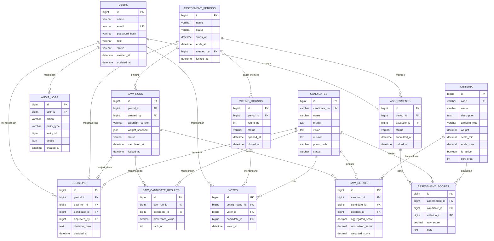
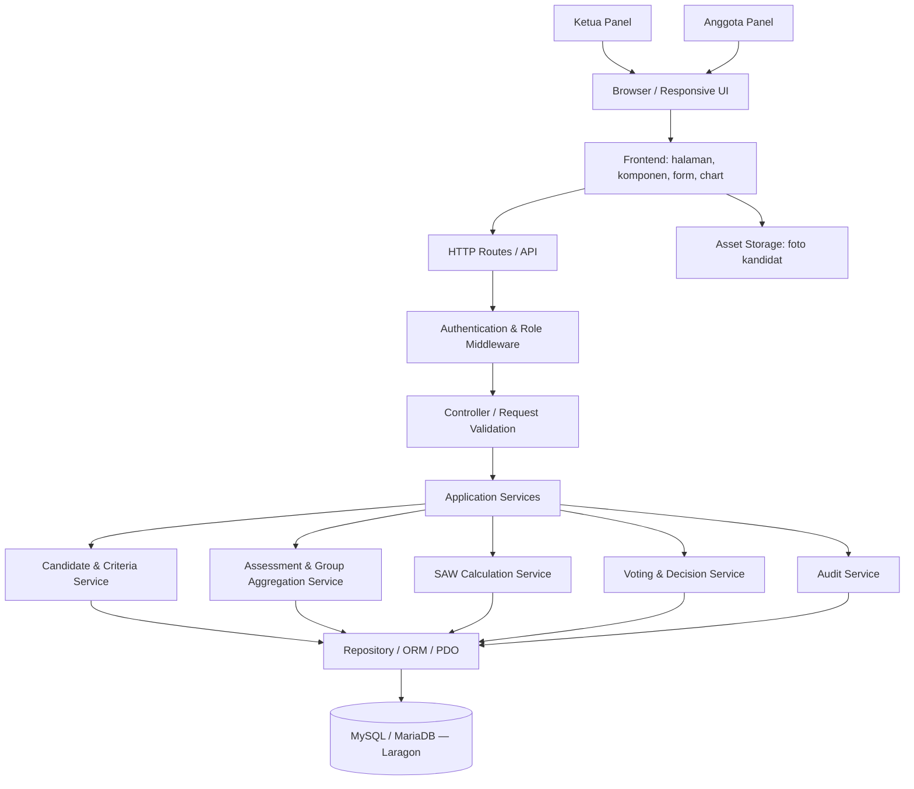

# PILPRESS — Product & Technical Blueprint

**Status:** Draft awal untuk validasi terhadap backend yang tersedia (superseded oleh implementasi final)  
**Produk:** Sistem Pendukung Keputusan Kelompok (GDSS) Pemilihan Calon Presiden  
**Metode utama (final):** TOPSIS untuk penilaian multikriteria, Borda untuk agregasi ranking  
**Metode utama (draft lama, superseded):** Simple Additive Weighting (SAW)  
**Database target:** MySQL/MariaDB melalui Laragon

> [!NOTE]
> Dokumen ini adalah baseline perencanaan historis. Bagian yang masih menyebut SAW sebagai metode utama mencerminkan rancangan awal dan sudah tidak berlaku. Metodologi final: TOPSIS (penilaian multikriteria) → ranking per DM → Borda (agregasi ranking). Endpoint SAW dipertahankan hanya sebagai legacy perbandingan.

> Dokumen ini adalah baseline perencanaan, bukan klaim bahwa struktur database atau fitur di bawah sudah ada pada source code. Sebelum implementasi, audit backend dan database aktual harus dilakukan. Nama tabel, framework, rute, role, serta alur voting wajib disesuaikan dengan hasil audit.

---

## 1. Product Requirements Document (PRD)

### 1.1 Project overview

Pilpress adalah aplikasi web untuk membantu panel pengambil keputusan mengelola data calon presiden, kriteria penilaian, bobot, penilaian oleh beberapa pengambil keputusan, perhitungan SAW, dan dokumentasi hasil keputusan. Sistem harus menjadikan proses penilaian transparan, dapat ditelusuri, dan konsisten antara data yang dimasukkan, hasil perhitungan, dan informasi yang ditampilkan.

### 1.2 Objectives and goals

1. Memusatkan data kandidat, kriteria, bobot, penilaian, dan hasil dalam satu sistem.
2. Mendukung penilaian kelompok dengan identitas dan hak akses setiap anggota panel.
3. Menghitung normalisasi serta nilai preferensi SAW di backend secara konsisten.
4. Menampilkan hasil dalam bentuk tabel yang dapat ditelusuri dan visualisasi yang mudah dipahami.
5. Menjaga integritas data melalui validasi, transaksi database, pembatasan akses, dan audit log.
6. Menyediakan antarmuka responsif untuk desktop, tablet, dan ponsel.

### 1.3 Target users and roles

| Role                                     | Tanggung jawab                                   | Hak akses rancangan awal                                                                                                                                        |
| ---------------------------------------- | ------------------------------------------------ | --------------------------------------------------------------------------------------------------------------------------------------------------------------- |
| Ketua Panel / DM1                        | Mengelola jalannya proses dan mengesahkan hasil  | Mengelola kandidat, kriteria, bobot, periode, anggota panel, membuka/menutup penilaian, menjalankan atau mengunci hasil SAW, mengelola keputusan, melihat audit |
| Anggota Panel / DM2, DM3, dan seterusnya | Memberikan penilaian sebagai pengambil keputusan | Melihat kandidat dan kriteria, mengisi serta mengirim penilaian, melihat hasil sesuai kebijakan akses, mengikuti voting bila modul tersebut memang digunakan    |

Role di atas adalah usulan berdasarkan konteks proyek GDSS. Role aktual, jumlah anggota, dan batas akses harus mengikuti backend serta ketentuan tugas.

### 1.4 Scope and functional requirements

**A. Authentication and authorization**

- Login dan logout.
- Password disimpan dalam bentuk hash, bukan teks biasa.
- Halaman dan aksi dilindungi otorisasi di backend, bukan hanya disembunyikan di frontend.
- Pengelolaan akun panel dilakukan oleh role yang berwenang; jangan membuat pendaftaran publik kecuali memang disyaratkan.

**B. Dashboard**

- Ringkasan jumlah kandidat, kriteria aktif, anggota panel, status penilaian, dan status proses.
- Ringkasan progres penilaian, misalnya `anggota yang sudah mengirim / total anggota`.
- Grafik hanya untuk memperjelas informasi; angka dan tabel tetap tersedia sebagai alternatif.

**C. Candidate management**

- Tambah, lihat, ubah, aktif/nonaktifkan data kandidat.
- Informasi minimum: nama, nomor/identitas urut, foto opsional, profil ringkas, visi, misi, dan status.
- Validasi format, panjang teks, dan file foto.
- Kandidat yang sudah masuk penilaian atau hasil final tidak dihapus permanen tanpa prosedur yang jelas.

**D. Criteria and weight management**

- Tambah, ubah, urutkan, aktif/nonaktifkan kriteria.
- Setiap kriteria memiliki kode unik, nama, deskripsi, tipe atribut (`benefit` atau `cost`), bobot, dan aturan skala.
- Total bobot kriteria aktif harus 1.0 atau 100% sebelum perhitungan dijalankan.
- Perubahan bobot setelah perhitungan harus menghasilkan versi/snapshot baru; hasil lama tidak boleh berubah diam-diam.

**E. Group assessment**

- Anggota panel mengisi skor setiap kandidat untuk setiap kriteria.
- Sistem menampilkan progres dan kelengkapan penilaian.
- Skor dibatasi sesuai skala yang ditetapkan (contoh skala 1–5 hanya digunakan jika sudah dikonfirmasi).
- Penilaian memiliki status draft/submitted/locked.
- Satu anggota tidak boleh mengirim penilaian ganda untuk kombinasi periode dan kandidat-kriteria yang sama.
- Penilaian yang sudah dikirim hanya dapat direvisi berdasarkan aturan dan status periode.

**F. SAW calculation**

- Backend memvalidasi bahwa semua penilaian wajib lengkap dan bobot valid.
- Backend melakukan agregasi penilaian kelompok sesuai kebijakan yang disepakati (contoh: rata-rata skor antaranggota untuk setiap kandidat dan kriteria).
- Backend melakukan normalisasi benefit/cost, perkalian bobot, dan penjumlahan nilai preferensi.
- Hasil menyimpan jejak data sumber, bobot, formula/versi algoritma, waktu kalkulasi, dan pengguna yang menjalankan proses.
- Peringkat ditampilkan dari nilai preferensi tertinggi ke terendah; aturan nilai seri harus ditentukan.
- Perhitungan ulang membuat run baru atau versi baru, bukan menimpa riwayat tanpa jejak.

**G. Voting and final decision (conditional)**

- Modul voting hanya diimplementasikan bila memang termasuk kebutuhan GDSS dan tersedia/direncanakan pada backend.
- Bila digunakan: setiap anggota hanya dapat memberikan satu suara per putaran; hasil seri, mayoritas, atau putaran ulang mengikuti aturan yang terdokumentasi.
- Keputusan final mencatat kandidat terpilih, dasar keputusan, periode, hasil SAW yang digunakan, pemberi persetujuan, dan waktu pengesahan.

**H. Reports and audit trail**

- Rekap skor, bobot, normalisasi, kontribusi terbobot, nilai preferensi, dan peringkat.
- Riwayat perubahan data penting dan aksi sensitif.
- Ekspor PDF/Excel dapat menjadi fitur lanjutan setelah format laporan disepakati.

### 1.5 Core user journeys

**Ketua Panel**

1. Login.
2. Memeriksa dashboard dan status periode.
3. Menyiapkan kandidat, kriteria, bobot, serta anggota panel.
4. Membuka periode penilaian.
5. Memantau kelengkapan penilaian.
6. Menutup penilaian ketika syarat terpenuhi.
7. Menjalankan perhitungan SAW.
8. Memeriksa detail perhitungan, mengunci hasil, dan mengesahkan keputusan sesuai aturan.

**Anggota Panel**

1. Login.
2. Membaca daftar kandidat dan kriteria.
3. Mengisi skor secara bertahap.
4. Memeriksa ringkasan dan mengirim penilaian.
5. Melihat status penilaian dan hasil sesuai hak akses.

### 1.6 User stories

- Sebagai Ketua Panel, saya ingin mengatur bobot kriteria agar penilaian mencerminkan prioritas yang telah disepakati.
- Sebagai Anggota Panel, saya ingin melihat deskripsi kriteria dan kandidat agar skor yang saya berikan memiliki dasar yang jelas.
- Sebagai Anggota Panel, saya ingin menyimpan draft agar pekerjaan tidak hilang ketika belum selesai.
- Sebagai Ketua Panel, saya ingin mengetahui anggota yang belum mengirim penilaian agar proses dapat dipantau.
- Sebagai Ketua Panel, saya ingin melihat rincian normalisasi dan kontribusi setiap kriteria agar hasil SAW dapat diaudit.
- Sebagai pengguna, saya ingin mengetahui alasan validasi gagal agar dapat memperbaiki input tanpa menebak.

### 1.7 Acceptance criteria

1. Pengguna yang belum login tidak dapat membuka halaman internal.
2. Anggota panel tidak dapat menjalankan aksi khusus Ketua Panel dengan memanggil URL/API secara langsung.
3. Perhitungan tidak dapat dijalankan ketika bobot tidak valid atau penilaian wajib belum lengkap.
4. Total bobot kriteria aktif tepat 1.0 (dengan toleransi desimal yang ditentukan backend) sebelum proses kalkulasi.
5. Normalisasi benefit dan cost menghasilkan nilai sesuai rumus yang telah disetujui.
6. Total preferensi kandidat sama dengan jumlah seluruh nilai normalisasi yang telah dikalikan bobot, dengan pembulatan hanya pada tahap tampilan kecuali spesifikasi menyatakan lain.
7. Hasil dapat ditelusuri ke skor sumber, bobot, periode, dan versi kalkulasi.
8. Refresh halaman tidak menghilangkan data penilaian yang sudah tersimpan.
9. Layout utama berfungsi pada lebar layar ponsel, tablet, dan desktop tanpa scroll horizontal yang tidak perlu.
10. Semua state penting tersedia: loading, kosong, berhasil, gagal, validasi, dan akses ditolak.

### 1.8 Non-functional requirements

- **Security:** hash password, session aman, validasi input server-side, perlindungan CSRF bila menggunakan session/cookie, escaping output, query parameterized/ORM, rate limiting login, dan otorisasi per aksi.
- **Integrity:** foreign key, unique constraint, transaksi database, soft-delete/status untuk data yang telah dipakai, dan snapshot kalkulasi.
- **Performance:** pagination pada tabel panjang, indeks untuk foreign key dan filter, eager loading/join yang sesuai, optimasi gambar, serta pembatasan JavaScript.
- **Accessibility:** label form, kontras memadai, navigasi keyboard, fokus terlihat, pesan error yang jelas, dan tabel sebagai alternatif grafik.
- **Maintainability:** pemisahan UI, controller/handler, service domain, dan akses data; penamaan konsisten; konfigurasi tidak di-hardcode.
- **Compatibility:** jalankan sesuai versi PHP/framework/database yang terdeteksi di proyek, bukan menaikkan versi secara sepihak.
- **Deployment:** gunakan Laragon untuk pengembangan dan pengujian lokal; tentukan target hosting/produksi secara terpisah karena konfigurasi Laragon lokal tidak otomatis menjadi konfigurasi produksi.

### 1.9 Timeline and milestones (estimasi awal)

| Tahap                  | Aktivitas                                                                       | Keluaran                             |
| ---------------------- | ------------------------------------------------------------------------------- | ------------------------------------ |
| 1. Audit & discovery   | Periksa source, route, database, autentikasi, role, dan cara menjalankan proyek | Laporan audit dan daftar gap         |
| 2. Analisis & desain   | Finalisasi PRD, ERD, alur GDSS-SAW, wireframe, dan design tokens                | Dokumen yang disetujui               |
| 3. Fondasi sistem      | Rapikan struktur modul, autentikasi, role, validasi, dan integrasi DB           | Fondasi aplikasi stabil              |
| 4. Fitur inti          | Kandidat, kriteria, bobot, penilaian, agregasi, dan SAW                         | Alur utama berfungsi                 |
| 5. UI/UX & visualisasi | Dashboard, tabel, chart, responsivitas, dan state UI                            | Antarmuka siap diuji                 |
| 6. QA & rilis          | Uji kalkulasi, otorisasi, alur pengguna, performa, dan backup                   | Kandidat rilis dan catatan pengujian |

Durasi per tahap ditentukan setelah audit ukuran dan kondisi source code; tabel ini bukan komitmen jadwal.

### 1.10 Budget and resources

- **Sumber daya pengembangan lokal:** Laragon, editor kode, Git, browser, dan MySQL/MariaDB yang sudah tersedia.
- **Dokumentasi/desain:** Mermaid, diagrams.net, atau Figma sesuai kebutuhan.
- **Dependensi:** utamakan library yang sudah ada di proyek; hindari menambah paket tanpa alasan dan pemeriksaan kompatibilitas.
- **Biaya hosting/domain:** belum ditentukan karena target deployment belum dijelaskan.
- **Peran kerja:** analis sistem, UI/UX designer, backend developer, frontend developer, dan tester. Satu orang dapat merangkap beberapa peran pada proyek akademik.

---

## 2. ERD — rancangan konseptual

ERD berikut adalah rancangan logis untuk diskusi. Nama dan kolom final harus dicocokkan dengan tabel aktual agar tidak membuat skema duplikat.

### 2.1 Constraint recommendations

- `users.email`, `candidates.candidate_no`, dan `criteria.code` harus unik.
- `assessments`: unique `(period_id, assessor_id)` bila satu anggota hanya memiliki satu lembar penilaian per periode.
- `assessment_scores`: unique `(assessment_id, candidate_id, criterion_id)`.
- `saw_details`: unique `(saw_run_id, candidate_id, criterion_id)`.
- `saw_candidate_results`: unique `(saw_run_id, candidate_id)`.
- `votes`: unique `(voting_round_id, voter_id)` bila satu suara per orang per putaran.
- Semua foreign key memiliki kebijakan `ON DELETE` yang aman. Untuk data historis, utamakan menonaktifkan/soft-delete daripada menghapus permanen.
- Gunakan `DECIMAL` untuk bobot dan nilai perhitungan, bukan `FLOAT` bila presisi desimal penting.
- Tambahkan indeks untuk seluruh foreign key serta kolom yang sering dipakai untuk filter status/periode.

### 2.2 Decisions that must be confirmed

1. Apakah nilai kelompok dihitung dari rata-rata skor semua anggota, median, atau metode agregasi lain?
2. Apakah setiap anggota harus menilai semua kandidat dan semua kriteria?
3. Apakah skala skor 1–5 benar-benar ketentuan proyek?
4. Kriteria mana yang benefit dan mana yang cost?
5. Apakah voting merupakan tahap terpisah setelah SAW atau SAW saja yang menentukan peringkat?
6. Bagaimana menangani nilai seri, anggota yang tidak mengirim penilaian, dan revisi setelah submit?

---

## 3. Formula and calculation flow — SAW (superseded; lihat catatan status di atas)

### 3.1 Group aggregation

Untuk kandidat `i`, kriteria `j`, dan anggota panel `k`, skor kelompok dapat dihitung dengan rata-rata bila itulah aturan yang disepakati:

\[
x*{ij} = \frac{1}{m}\sum*{k=1}^{m} x\_{ijk}
\]

`m` adalah jumlah penilaian valid untuk pasangan kandidat-kriteria. Sistem harus menetapkan apakah `m` wajib sama dengan seluruh anggota panel atau boleh menggunakan penilaian yang tersedia.

### 3.2 Normalization

- **Benefit:**

\[
r*{ij}=\frac{x*{ij}}{\max*i(x*{ij})}
\]

- **Cost:**

\[
r*{ij}=\frac{\min_i(x*{ij})}{x\_{ij}}
\]

Pastikan nilai pembagi tidak nol dan tentukan perlakuan untuk data kosong/nol sebelum kalkulasi.

### 3.3 Weighted preference

\[
V*i=\sum*{j=1}^{n} w*j r*{ij}
\]

Dengan syarat `Σw_j = 1`. Peringkat diurutkan berdasarkan `V_i` secara menurun. Simpan presisi internal yang konsisten; pembulatan sebaiknya dilakukan hanya pada tampilan.

### 3.4 Calculation pipeline

1. Validasi status periode, daftar kandidat, kriteria aktif, bobot, dan kelengkapan penilaian.
2. Buat snapshot bobot dan versi data masukan.
3. Agregasikan skor kelompok sesuai aturan yang disetujui.
4. Hitung nilai maksimum/minimum setiap kriteria.
5. Hitung nilai normalisasi setiap kandidat-kriteria.
6. Kalikan hasil normalisasi dengan bobot.
7. Jumlahkan kontribusi menjadi nilai preferensi kandidat.
8. Urutkan peringkat dan terapkan aturan nilai seri.
9. Simpan hasil dan rincian dalam satu transaksi database.
10. Tampilkan tabel rincian agar pengguna dapat memverifikasi setiap langkah.

---

## 4. System architecture

### 4.1 Architectural rules

- Laragon menjalankan layanan lokal seperti web server dan MySQL/MariaDB; framework dan pola aplikasi mengikuti source yang ditemukan.
- Jangan membuat frontend tiruan yang memakai data hardcoded ketika backend sudah memiliki endpoint atau query nyata.
- Pisahkan tanggung jawab: UI menampilkan dan memvalidasi ringan; backend memvalidasi otorisasi dan aturan bisnis; service menghitung SAW; database menyimpan data dan constraint.
- Perhitungan SAW harus menjadi sumber kebenaran di backend. Jangan percaya nilai akhir yang dikirim browser.
- Semua operasi yang menyimpan banyak baris hasil perhitungan harus menggunakan transaksi.
- Gunakan konfigurasi environment untuk kredensial. Jangan menampilkan atau menyalin nilai rahasia `.env` ke dokumentasi, prompt, atau commit.

---

## 5. Visual Design Document

### 5.1 Design direction

**Arah visual:** modern civic-tech — profesional, terpercaya, tenang, dan mudah dipindai. Hindari tampilan seperti portal berita yang padat atau dashboard dengan terlalu banyak kartu dan warna.

### 5.2 Suggested color tokens

| Token          | Hex       | Penggunaan                                              |
| -------------- | --------- | ------------------------------------------------------- |
| `navy-900`     | `#17263C` | Sidebar, header, teks utama pada area terang            |
| `navy-700`     | `#29415F` | Hover, elemen navigasi sekunder                         |
| `red-600`      | `#C7464F` | Aksi penting atau penanda pemilihan; gunakan secukupnya |
| `gold-500`     | `#D5A94B` | Aksen, nomor peringkat, highlight data                  |
| `surface`      | `#FFFFFF` | Kartu dan panel utama                                   |
| `canvas`       | `#F4F6F9` | Latar halaman                                           |
| `text-primary` | `#202B3A` | Teks utama                                              |
| `text-muted`   | `#697586` | Teks sekunder                                           |
| `border`       | `#E3E8EF` | Garis pemisah dan border                                |
| `success`      | `#23845B` | Status berhasil                                         |
| `warning`      | `#B7791F` | Status perlu perhatian                                  |
| `danger`       | `#B93838` | Error dan tindakan berisiko                             |

Pastikan kombinasi teks dan latar memenuhi kontras aksesibilitas; jangan mengandalkan warna saja untuk membedakan status.

### 5.3 Typography and layout

- Font utama: **Plus Jakarta Sans** atau **DM Sans**; gunakan satu keluarga utama agar konsisten.
- Gunakan skala tipografi terbatas: judul halaman, heading bagian, body, label, caption.
- Desktop: sidebar tetap + topbar ringkas + konten dengan lebar terkontrol.
- Tablet: sidebar dapat diciutkan.
- Mobile: navigasi menjadi drawer/bottom navigation sesuai jumlah menu; tabel lebar memiliki tampilan alternatif atau scroll dalam kontainer khusus.
- Gunakan grid 8 px, radius konsisten (8–14 px), ruang kosong cukup, dan shadow tipis.

### 5.4 Information architecture and pages

| Halaman           | Konten utama                                                          | Komponen penting                                        |
| ----------------- | --------------------------------------------------------------------- | ------------------------------------------------------- |
| Login             | Identitas Pilpress, email, password                                   | Form, show/hide password, error state                   |
| Dashboard Ketua   | Status periode, progres penilaian, ringkasan kandidat, hasil terakhir | KPI ringkas, progress, grafik SAW bila sudah ada hasil  |
| Dashboard Anggota | Status tugas penilaian, tenggat, ringkasan kandidat                   | Progress dan tombol lanjutkan penilaian                 |
| Kandidat          | Daftar dan detail kandidat                                            | Search, filter status, card/list, form                  |
| Kriteria & Bobot  | Daftar kriteria, tipe benefit/cost, bobot, total bobot                | Tabel editable atau form terpisah, validasi total       |
| Penilaian         | Matriks kandidat × kriteria                                           | Form skor, definisi skala, autosave/draft bila didukung |
| Hasil SAW         | Peringkat, nilai preferensi, detail normalisasi                       | Ranking table, bar chart, detail per kandidat           |
| Voting (opsional) | Putaran dan rekap suara                                               | Status putaran, pilihan, hasil                          |
| Keputusan         | Kandidat terpilih dan dasar keputusan                                 | Ringkasan, persetujuan, riwayat                         |
| Audit             | Riwayat aktivitas                                                     | Filter pengguna, aksi, tanggal                          |

### 5.5 Data visualization guidance (Graphify / charting)

Visualisasi yang disarankan setelah data nyata tersedia:

- **Bar chart:** perbandingan nilai preferensi SAW antar kandidat.
- **Horizontal bar chart:** kontribusi nilai terbobot untuk satu kandidat berdasarkan kriteria.
- **Donut atau progress bar:** distribusi bobot kriteria; jangan gunakan bila tabel bobot sudah lebih mudah dibaca.
- **Progress indicator:** jumlah anggota panel yang sudah menyelesaikan penilaian.

Setiap grafik harus memiliki judul, label sumbu/angka, tooltip yang bermakna, dan tabel atau ringkasan teks sebagai alternatif. Jangan membuat data contoh terlihat seperti hasil resmi.

### 5.6 UX states and interaction standards

- Sediakan skeleton/loading saat mengambil data.
- Sediakan empty state yang menjelaskan langkah berikutnya, bukan hanya tulisan “Tidak ada data”.
- Tampilkan validasi dekat field yang bermasalah dan ringkasan error untuk form panjang.
- Konfirmasi aksi yang tidak mudah dibatalkan, seperti mengunci periode atau mengesahkan keputusan.
- Berikan toast untuk hasil aksi, tetapi jangan menjadikan toast satu-satunya tempat menampilkan error penting.
- Pertahankan filter dan halaman tabel saat pengguna kembali dari detail bila memungkinkan.
- Gunakan istilah yang konsisten: “Kandidat”, “Kriteria”, “Bobot”, “Penilaian”, “Nilai Preferensi”, “Peringkat”, dan “Keputusan”.

---

## 6. UI/UX, performance, and skill workflow for OpenCode

Gunakan skill hanya setelah memeriksa nama, lokasi, dan instruksi aktualnya di environment OpenCode. Nama skill dapat berbeda dari label yang disebut dalam brief.

| Skill/reference | Cara menerapkan pada Pilpress                                                                                                                                 | Batasan                                                                     |
| --------------- | ------------------------------------------------------------------------------------------------------------------------------------------------------------- | --------------------------------------------------------------------------- |
| Graphify        | Petakan hubungan modul, dependensi, aliran data, serta titik masuk source; bantu memahami codebase dan/atau visualisasi sesuai kemampuan skill yang terpasang | Jangan menganggap Graphify otomatis menjadi library chart di aplikasi       |
| GSD             | Pecah pekerjaan menjadi fase kecil, tetapkan acceptance criteria, validasi tiap fase, dan hindari perubahan melebar                                           | Jangan menjalankan migrasi atau perubahan data destruktif tanpa persetujuan |
| UI-Styling      | Terapkan design tokens, tipografi, spacing, komponen, serta responsive rules secara konsisten                                                                 | Ikuti teknologi CSS yang sudah digunakan proyek                             |
| UI-UX-Pro-Max   | Audit alur pengguna, hierarki informasi, accessibility, feedback, empty/error/loading states                                                                  | Jangan mengganti pola navigasi tanpa alasan dari kebutuhan pengguna         |
| Design          | Rapikan konsistensi visual, komposisi halaman, tabel, form, dan dashboard                                                                                     | Hindari dekorasi yang mengganggu keterbacaan data                           |

### 6.1 Performance checklist

- Ukur baseline sebelum optimasi.
- Gunakan pagination dan pencarian server-side untuk data yang dapat bertambah.
- Periksa query berulang/N+1 dan tambahkan indeks berdasarkan pola query aktual.
- Kompres dan resize foto kandidat; gunakan lazy loading untuk gambar di luar viewport.
- Muat JavaScript seperlunya; hindari dependensi chart besar pada halaman yang tidak memakainya.
- Cache hanya data yang aman dan relatif stabil; invalidasi cache saat bobot, kandidat, atau penilaian berubah.
- Uji tampilan di lebar 360 px, 768 px, 1024 px, dan desktop.

### 6.2 Testing strategy

**Backend and database**

- Auth dan role access untuk setiap route/action.
- Validasi kandidat, kriteria, bobot, periode, dan skor.
- Constraint unik dan foreign key.
- Perhitungan benefit, cost, bobot total, nilai seri, skor nol/kosong, serta agregasi multi-anggota.
- Transaksi rollback ketika proses simpan hasil gagal.

**Frontend and UX**

- Login gagal/berhasil, form invalid, loading, empty, error, success.
- Submit dan revisi penilaian sesuai status.
- Responsivitas halaman tabel dan chart.
- Keyboard navigation, focus state, label, dan kontras.

**Regression**

- Jalankan test suite yang sudah ada setelah tiap perubahan.
- Bandingkan satu set data uji SAW dengan perhitungan manual/spreadsheet yang telah diverifikasi.
- Pastikan data historis tidak berubah ketika bobot atau kriteria baru diedit.

---

## 7. Backend audit checklist before implementation

1. Catat framework dan versi runtime dari file manifest serta konfigurasi proyek.
2. Periksa struktur folder frontend, backend, route, controller, service, model, migration, dan test.
3. Periksa skema database aktif dan daftar tabel; jangan hanya mengandalkan migration yang terlihat.
4. Cocokkan role di database dengan middleware/authorization di backend.
5. Petakan setiap halaman ke route/controller/API dan tabel yang menjadi sumber data.
6. Identifikasi perhitungan SAW yang sudah ada dan bandingkan dengan formula yang disepakati.
7. Catat fitur yang sudah berjalan, setengah jadi, duplikat, atau belum ada.
8. Jalankan proyek melalui Laragon sesuai konfigurasi aktual dan catat langkah start yang berhasil.
9. Periksa log error dan test yang sudah tersedia.
10. Buat rencana perubahan terkecil sebelum mengedit source atau database.

**Proteksi wajib selama audit:** jangan menjalankan `migrate:fresh`, `db:wipe`, `DROP TABLE`, reset database, atau seeding yang menghapus data; jangan menimpa `.env`; jangan mengubah schema atau data pengguna tanpa backup dan persetujuan; jangan commit atau push kecuali diminta.

---

## 8. Items to validate with the project owner

- Verifikasi apakah database `gdss_pemilihan_presiden` dari konfigurasi backend yang telah disiapkan merupakan database aktif Pilpress; pastikan dengan memeriksa koneksi dan skema aktual, tanpa mengubah data.
- Framework/backend yang aktif: PHP native + PDO, Laravel, atau stack lain?
- Role final dan jumlah anggota panel.
- Apakah agregasi skor kelompok menggunakan rata-rata?
- Apakah skala penilaian 1–5 dan bobot kriteria sudah final?
- Apakah sistem memakai voting terpisah setelah hasil SAW?
- Apakah hasil SAW hanya rekomendasi atau menjadi dasar keputusan final?
- Apakah ada format laporan/identitas kampus yang wajib diikuti?

**Prinsip keputusan:** jangan mengubah aturan metode, skema database, atau alur keputusan berdasarkan asumsi desain. Validasi kebutuhan dan backend terlebih dahulu, lalu implementasikan secara bertahap.
